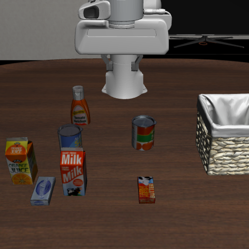

# 基于 LeRobot、LIBERO 与 SmolVLA 的自定义机器人任务评测

姓名：________　学号：________　班级：________

实验日期：2026 年 10 月 20 日

> 本稿依据已完成的实验、结果 JSON、日志和录像整理。个人信息、报告排版及提交命名需按课程通知补充。未进行模型训练或微调。

## 1. 实验任务

本实验在课程提供的 Scene B（Living Room Object Selection）中选取“将牛奶放入篮子”作为自定义操作任务。输入的自然语言指令为：

```text
Put the milk in the basket.
```

场景包含牛奶、橙汁、罐装食品、番茄酱等物体，以及用于放置物体的篮子。任务生成脚本将指令解析为如下目标条件：

```text
(In milk_1 basket_1_contain_region)
```

目标物体为 `milk_1`，目标区域为 `basket_1_contain_region`。任务生成时，脚本成功创建并验证 BDDL、JSON 和 PNG 文件；检查显示初始状态未满足目标条件。因此，评测需要机器人通过实际动作完成目标，而不是在初始化后直接判定成功。



图1：任务生成器保存的初始场景预览。红白色 Milk 包装对应牛奶盒，篮子为放置目标。

## 2. 实验环境

实验使用 AutoDL 云端 Linux GPU 实例运行，本地电脑用于远程操作、下载材料与查看录像。

| 项目 | 本次配置 |
| --- | --- |
| GPU | NVIDIA GeForce RTX 3090，24576 MiB 显存 |
| 系统 | Ubuntu 22.04 基础镜像 |
| Python | 3.12.15，独立 Conda 环境 |
| LeRobot | v0.6.1 |
| PyTorch | 2.8.0+cu128 |
| 仿真环境 | LIBERO，MuJoCo 3.8.1 |
| 渲染后端 | EGL，初始化检查通过 |
| 策略模型 | `lerobot/smolvla_libero` |
| 视觉语言骨干 | `HuggingFaceTB/SmolVLM2-500M-Video-Instruct` |
| 课程脚本 | `libero_custom_task_builder.py`、`custom_vla_eval.py` |

基础环境检查确认 CUDA 可用、MuJoCo EGL 上下文创建成功。前期官方 `libero_spatial` task 0 的单次验收运行成功，用于验证环境链路，不计入本次自定义任务成功率。正式实验使用课程提供的脚本，没有修改模型、相机、图像尺寸或动作处理代码。

## 3. 实验设置与次数

先通过任务生成脚本选择场景 B、输入任务指令，检查解析目标与预览；之后通过评测脚本执行 5 个 episodes。模型文件下载完整后，使用本地缓存进行离线加载。

关键设置由实验日志和 `results.json` 核对如下：

| 设置项 | 数值 |
| --- | --- |
| Base suite | `libero_10` |
| Base task ID | 0 |
| Episodes | 5 |
| 随机种子 | 0、1、2、3、4 |
| 固定初始状态 | True |
| 初始状态索引 | 0 |
| 每次最大执行步数 | 520 |
| 观测图像尺寸 | 256 × 256 |
| 主相机映射 | `agentview_image` → `camera1` |
| 手部相机映射 | `robot0_eye_in_hand_image` → `camera2` |
| 执行设备 | CUDA |

五次运行保持相同初始状态，并使用不同随机种子。因此，这五次结果反映同一个固定布局下的重复表现，不代表覆盖五个不同场景或初始布局。

实际执行命令的主要部分为：

```bash
HF_HUB_OFFLINE=1 TRANSFORMERS_OFFLINE=1 \
python custom_vla_eval.py \
  --task /root/lerobot/custom_libero_tasks/scene_B/put_the_milk_in_the_basket.json \
  --episodes 5 \
  --device cuda
```

## 4. 实验结果

评测程序正常完成，保存了结果 JSON 和 5 个 rollout 视频。逐次结果如下：

| Episode | Seed | 结果 | 已执行步数 |
| --- | --- | --- | --- |
| 00 | 0 | FAILURE | 520 |
| 01 | 1 | FAILURE | 520 |
| 02 | 2 | FAILURE | 520 |
| 03 | 3 | FAILURE | 520 |
| 04 | 4 | FAILURE | 520 |

```text
Successful Episodes: 0
Total Episodes: 5
Success Rate: 0 / 5 × 100% = 0.0%
```

五次运行均到达 520 步上限，且未满足最终目标条件。脚本的 FAILURE 判定与录像中牛奶最终留在篮外的可见状态一致。

## 5. Rollout 展示

五段视频均为 20 fps、521 帧，时长约 26.05 秒，包含初始帧和执行过程。以下时间为视频播放时间，不是云端实际计算耗时。

全部五次录像的动作模式接近。以 Episode 00 为代表，可分为以下阶段：

| 视频时间 | 观察结果 |
| --- | --- |
| 约 1–3 秒 | 机械臂向牛奶所在区域接近，夹爪下降。 |
| 约 3.2–4.1 秒 | 牛奶盒发生倾斜、转动，并向画面下方移位；没有形成持续的稳定抓持搬运。 |
| 约 4.2–5 秒 | 机械臂抬起，牛奶没有随夹爪继续移动，仍留在桌面。 |
| 约 6–26 秒 | 机械臂在桌面上方反复升降、摆动，未将牛奶搬入篮子。 |
| 约 26 秒 | 牛奶仍位于篮外，程序按步数上限结束本次尝试。 |


图2：依次为 2.00 秒接近牛奶、3.75 秒牛奶移位、5.00 秒夹爪抬起但牛奶留在桌面，以及 26.00 秒结束时的状态。拼图为方便阅读进行了放大，原始视频分辨率为 256×256。

初始预览与 rollout 截图呈现的左右方向有所不同，图中均保留原始文件方向。本文通过物体外观、标识与任务谓词确定操作对象，不仅依据画面的左右位置判断任务状态。

## 6. 失败分析

### 6.1 抓取搬运未能建立

录像显示，机械臂能够接近牛奶所在区域，但接近目标并不等同于成功抓取。接触阶段牛奶盒发生明显姿态变化和移位，而夹爪抬起后，牛奶仍停留在桌面。没有观察到牛奶被稳定抓持并持续搬向篮子的完整过程。因此，本轮首先暴露的问题位于抓取及抓持保持阶段。

部分画面中夹爪与物体接触区域被遮挡，无法仅凭单视角视频确定是否发生过短暂夹持，或准确区分接触滑动与短暂抬起。这里将结论限定为“未形成稳定抓取搬运”。

### 6.2 初次接触失败后，后续动作未恢复完成任务

牛奶移位并留在桌面后，机械臂继续执行反复升降和摆动，但没有重新完成有效抓取，也没有让牛奶进入篮子。该现象说明，本轮执行过程中后续行为未能补救初次接触后的失败。

无法从画面直接判断模型是否具有内部的“重试意图”，因此不把重复动作本身写成成功的恢复策略。

### 6.3 存在邻近物体扰动，但因果关系尚不明确

部分录像中，邻近橙汁盒也出现倾斜或移位。该现象提示操作过程中存在对非目标物体的扰动，但视频分辨率和遮挡限制了具体接触点的判断，不能据此认定某次碰撞是唯一失败原因。

### 6.4 结论边界

本次分析依据的是视频行为和成功判定。抓取位置、夹爪闭合时机、视觉输入处理、动作适配及模型策略都可能影响表现，但尚未通过控制变量实验或额外状态记录定位底层原因。因此，本报告将“抓取搬运未建立”和“后续恢复无效”作为已观察到的失败现象，不将某个未验证的技术原因写成事实。

本轮也没有显示已经把牛奶稳定搬到篮子上方后再放置失败，因此现有证据主要支持分析抓取与恢复阶段。

## 7. 总结

本实验完成了 LeRobot v0.6.1、LIBERO 与 SmolVLA 的云端环境配置、官方链路验收、自定义任务生成和 5 次正式评测。在固定初始布局的“将牛奶放入篮子”任务中，五次均未满足最终目标，成功率为 0.0%。

录像反映的主要问题是机械臂接近并扰动牛奶后，未形成稳定抓取搬运，后续反复动作也未恢复完成任务。该结果说明，本次配置和任务条件下，执行链路仍存在明显的抓取与恢复问题；不能由单任务、固定布局下的五次失败推断模型在所有场景中的能力。

若后续继续研究，可在保持课程规定模型与处理代码不变的前提下，增加不同任务或初始布局的对照，并保存更完整的状态记录，以进一步区分目标选择、抓取执行和评测适配等因素。本次结果已按实际观测保留，不以追加实验替换或隐去失败记录。

## 附件索引

原始材料保存在仓库 `artifacts/` 下，保留云端原始 JSON、日志和全部五次录像。JSON 中的 `/root/lerobot/...` 是实验时的路径；下载后通过仓库内对应文件夹查找同名文件。

- [任务定义](../artifacts/custom_libero_tasks/scene_B/put_the_milk_in_the_basket.bddl)
- [元数据](../artifacts/custom_libero_tasks/scene_B/put_the_milk_in_the_basket.json)
- [原始结果](../artifacts/custom_vla_outputs/scene_B/put_the_milk_in_the_basket/results.json)
- [全部五次录像](../artifacts/custom_vla_outputs/scene_B/put_the_milk_in_the_basket/)
- [五次评测关键帧对照](../figures/五次评测关键帧对照.png)

本稿覆盖已完成的 T01。T02–T05 的补充实验尚未完成，不能作为最终多任务报告提交。完整任务计划见 [实验计划](../experiments/plan.json)。课程要求来源为 [大作业操作指导](../docs/大作业操作指导.pdf)。
