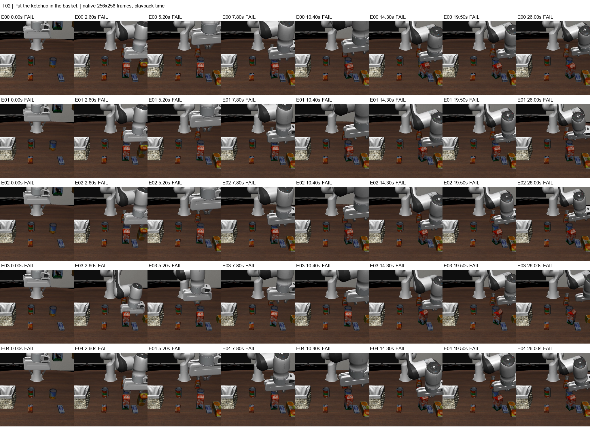
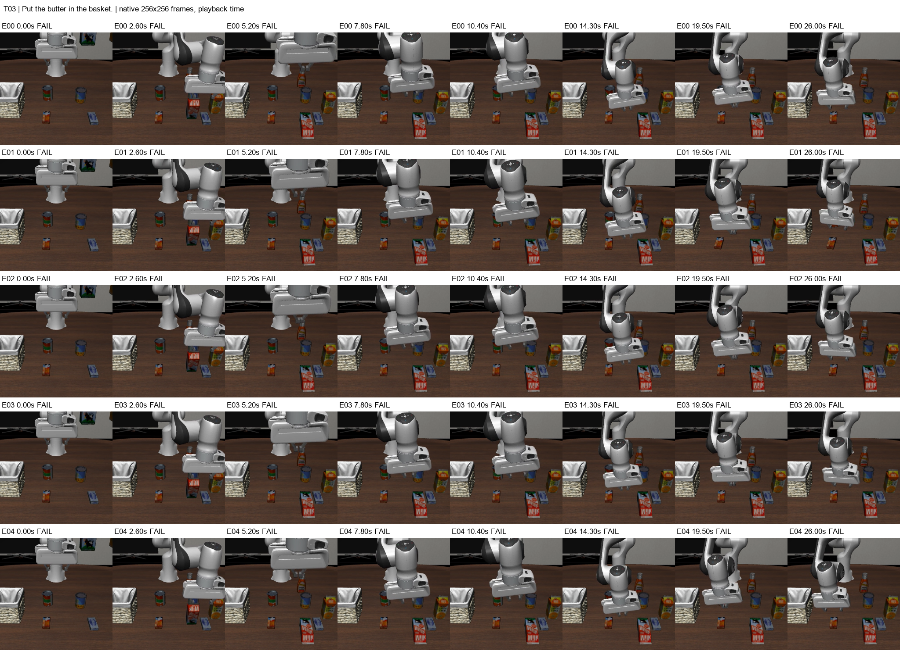
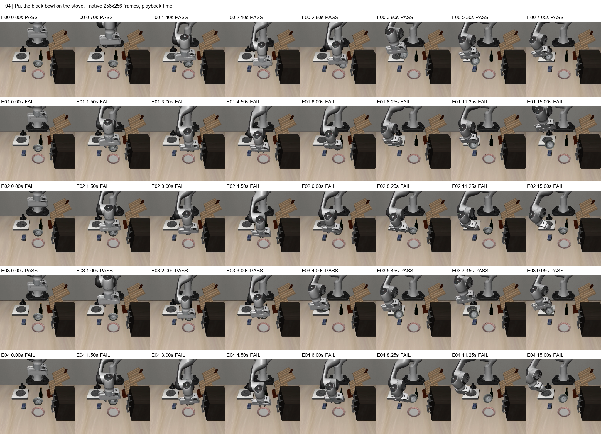
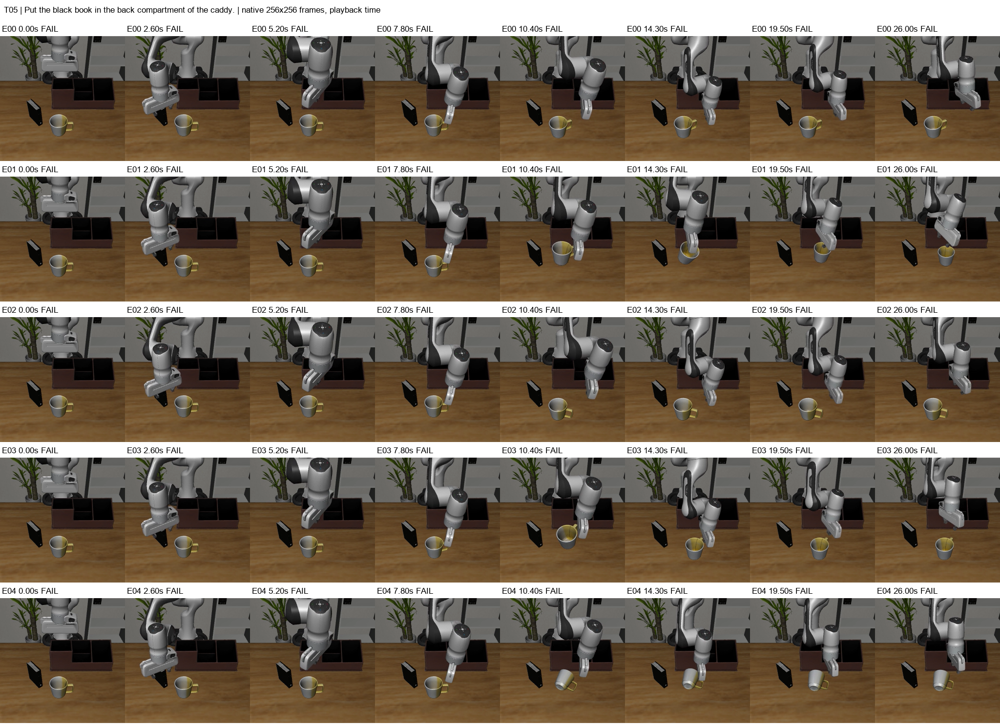

# 基于 LeRobot、LIBERO 与 SmolVLA 的五任务评测

姓名：________　学号：________　班级：________

实验日期：2026 年 10 月 20 日。五个任务、25 次评测均已完成。本文依据原始 JSON、运行日志、环境快照与逐视频抽样帧编写；未训练或微调模型。个人信息与课程要求的封面格式由提交者补充。

## 1. 实验任务

在课程允许的三个场景中设计以下受控英文任务。教师生成器保留原场景物体与布局，创建并验证 BDDL、JSON 和初始场景 PNG；五个任务的初始状态均未满足 Goal。

| ID | 场景 | 英文指令 | Goal |
| --- | --- | --- | --- |
| T01 | B 客厅 | Put the milk in the basket. | `(In milk_1 basket_1_contain_region)` |
| T02 | B 客厅 | Put the ketchup in the basket. | `(In ketchup_1 basket_1_contain_region)` |
| T03 | B 客厅 | Put the butter in the basket. | `(In butter_1 basket_1_contain_region)` |
| T04 | A 厨房 | Put the black bowl on the stove. | `(On akita_black_bowl_1 flat_stove_1_cook_region)` |
| T05 | C 书桌 | Put the black book in the back compartment of the caddy. | `(In black_book_1 desk_caddy_1_back_contain_region)` |

T01–T03 使用相同句式与同一篮子目标，改变目标物体；T04/T05 扩展场景覆盖。物体身份、形状等同时变化，不能把差异直接归因为单一物理属性。五种任务是本项目的设计，课程建议每个最终任务至少评测五次，没有规定必须选五种任务。

## 2. 实验环境

| 项目 | 实际配置 |
| --- | --- |
| 平台 / GPU | AutoDL，Ubuntu 22.04 基础镜像 / RTX 3090 24576 MiB |
| Python | 3.12.15，独立 Conda 环境 |
| LeRobot | v0.6.1，commit `7e241bd630a3719a56157a497ce5d08f244784f1` |
| PyTorch / torchvision | 2.8.0+cu128 / 0.23.0+cu128 |
| LIBERO 包 / MuJoCo | hf_libero 0.1.4 / MuJoCo 3.8.1 |
| NVIDIA 驱动 / 渲染后端 | 595.71.05 / EGL |
| 策略 / 视觉语言骨干 | `lerobot/smolvla_libero` / `HuggingFaceTB/SmolVLM2-500M-Video-Instruct` |

课程两份脚本按原始字节保存，SHA256 与云端运行记录一致。辅助工作流只负责调用、记录、校验和打包，不改模型、相机、图像尺寸、动作处理或成功判定。模型从已下载缓存离线加载。[实际环境快照](../artifacts/course_records/environment_20261020T031302_487523Z/)包含完整依赖、GPU 和源码版本；安装步骤见[环境说明](../docs/environment.md)。

CUDA、MuJoCo EGL 与官方单任务 smoke test 均已验收。官方测试的 1/1 成功仅验证链路，不计入自定义任务统计。

## 3. 实验次数

五任务各五次，共 25 episodes。每任务 seeds 为 0–4，固定官方初始状态索引 0；这五次重复不代表五个不同布局。

| 设置 | 数值 |
| --- | --- |
| Scene A suite / task ID / 最大步数 | `libero_goal` / 9 / 300 |
| Scene B suite / task ID / 最大步数 | `libero_10` / 0 / 520 |
| Scene C suite / task ID / 最大步数 | `libero_10` / 5 / 520 |
| 设备 / empty cameras | CUDA / 教师默认 1 |
| 观测尺寸 / 视频 FPS | 256×256 / 20 |
| 主相机 / 手部相机映射 | `agentview_image → camera1` / `robot0_eye_in_hand_image → camera2` |

各场景沿用教师默认步数预算，因此跨场景比较并非单变量消融。按 LIBERO Goal 记录 SUCCESS 或 FAILURE，接近目标不改记为成功。首次牛奶失败记录保持原样，没有被追加实验替换。

## 4. 实验结果

| 任务 | 成功 / 次数 | 成功率 | Episode 00–04 步数 |
| --- | --- | --- | --- |
| T01 牛奶入篮 | 0/5 | 0.0% | 520、520、520、520、520 |
| T02 番茄酱入篮 | 0/5 | 0.0% | 520、520、520、520、520 |
| T03 黄油入篮 | 0/5 | 0.0% | 520、520、520、520、520 |
| T04 黑碗放上炉灶 | 2/5 | 40.0% | **141 成功**、300、300、**199 成功**、300 |
| T05 黑书放入后格 | 0/5 | 0.0% | 520、520、520、520、520 |
| 合计 | **2/25** | **8.0%** | 23 次失败均达到各自步数上限 |

合计成功率为成功 episode 总数除以 25。由于每个任务均为五次，也等于任务成功率的算术平均。它只描述这五个选定任务和固定布局，不是整个 LIBERO 的性能估计。

五份结果 JSON、25 段原视频和生成/评测日志完整保存，并通过导出 SHA256 校验。视频均为 256×256、20 fps，帧数等于执行步数加初始帧；见[自动统计](../experiments/summary.csv)与[视频元数据](../experiments/video_metadata.csv)。

## 5. Rollout 展示

全部 25 段录像见[附件索引](../docs/artifacts.md)。拼图每行对应一个 episode，展示全时段的八个抽样帧。PASS/FAIL 为整段最终结果，不是每一帧的即时判定；时间为视频播放时间，不是计算耗时。

**T01：牛奶入篮。** 接近并接触牛奶后，牛奶倾斜、移位，抬爪时仍留在桌面，没有形成稳定抓持搬运。后续重复动作未恢复完成任务。详细接触阶段分析见[单任务报告](T01_milk_basket.md)。

**T02：番茄酱入篮。** 五次关键帧中机械臂主要在牛奶与邻近物体附近活动，牛奶出现倾斜或移位，没有观察到番茄酱被持续搬运入篮。五次均达到 520 步上限。

**T03：黄油入篮。** 出现接触、推动牛奶等非目标物体的行为，牛奶在画面前方发生明显姿态变化，而黄油未进入篮子。五次均为 520 步 FAILURE。低分辨率和夹爪遮挡限制了对短暂夹持的判断。

**T04：黑碗放上炉灶。** Episode 00、03 中，碗随夹爪移动，日志分别在 141、199 步记录成功；Episode 01、02、04 虽也接触、移动碗，但到 300 步仍未满足 Goal。接近炉灶不等于完成放置。成功运行在首次满足 Goal 时结束，末帧存在夹爪与碗的遮挡，本文不额外声称验证了完全松爪、撤离后的长期稳定放置。

**T05：黑书放入后格。** 黑书未进入后格，仍可见于桌面。机械臂多次接近、接触杯子，部分运行中杯子发生位移或倾倒。非目标杯子的移动不能计为黑书任务的进展。

## 6. 失败分析

**目标物体相关行为不一致。** T02/T03 改变了指令中的目标物体，仍出现对牛奶等物体的操作；T05 出现对杯子的接触。就可见行为而言，这些运行没有稳定地操作指令指定对象，但不能据此证明模型内部没有理解语言。

**接近、抓持与完成放置需要区分。** T01 能接近牛奶，但未建立持续搬运；T04 的部分失败运行可以移动黑碗，却没有满足最终目标。失败发生于不同阶段，不能一概称为“没有抓住”。

**失败后的后续行为未恢复任务。** 客厅与书桌出现重复升降、摆动和邻物扰动，目标仍未完成。没有内部状态记录，不能将重复动作描述为经过验证的主动恢复策略。

**底层原因与证据边界。** 策略、输入处理、相机方向、动作适配等都可能影响执行，但本实验未修改这些处理进行消融，不能指定唯一技术根因。预览图与 rollout 可能显示方向不同，均保留原始方向，不能仅据此认定模型输入错误。

分析方法为逐视频元数据检查及跨时段抽帧复核，T01 另有接触阶段细查；抽样可能遗漏短暂接触，不能替代状态轨迹与力记录。所有完整原视频均保留，便于进一步复查。

## 7. 总结

本项目完成环境验收、五个自定义任务生成与验证、25 次评测、材料导出和视频抽帧核对。黑碗任务成功 2/5，其余四任务均为 0/5，合计 8%。当前配置存在可触发厨房任务成功谓词的运行；客厅与书桌任务中则出现非目标物体操作、抓持搬运未建立及后续恢复无效等现象。

小样本、固定布局、跨场景步数预算不同以及未做技术消融限制了结论范围，不能据此推广模型在所有任务中的能力。成功与失败数据全部保留，不通过隐藏失败录像提高结果。

附件：[全部视频及原始文件](../docs/artifacts.md)、[课程要求](../docs/大作业操作指导.pdf)、[原版脚本校验](../course_scripts/SHA256.json)、[逐视频检查表](../experiments/video_review.csv)、[运行日志](../artifacts/course_records/)。
