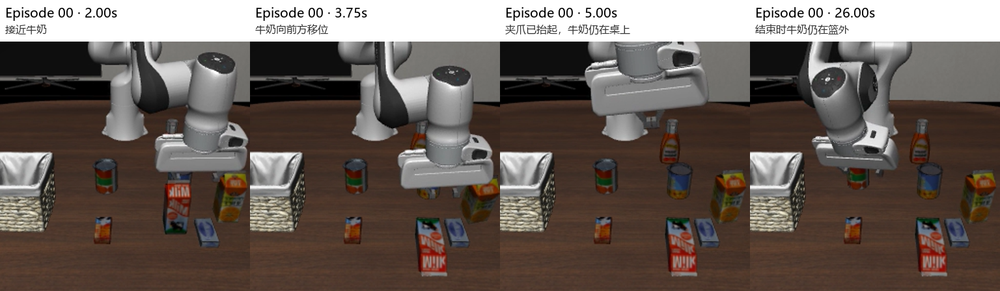

# LeRobot / LIBERO / SmolVLA 多任务评测报告（待完成）

姓名：________　学号：________　班级：________

当前仅 T01 完成；本文件是后续填写框架，尚不能作为五任务完成报告。结果以 [原始 JSON](../artifacts/custom_vla_outputs/) 与 [自动汇总](../experiments/summary.csv) 为准。

## 1. 实验任务

设计五个受控英文任务，覆盖客厅物体选择、厨房放置、书桌空间目标。完整指令及 Goal 见 [plan.json](../experiments/plan.json)。T01/T02/T03 采用同一句式与同一篮子目标，改变物体；T04/T05 扩展场景覆盖。实验数量是本项目选择，不是课程额外硬性规定。

## 2. 实验环境

AutoDL RTX 3090 24GB，Ubuntu 22.04，Python 3.12.15，LeRobot v0.6.1，PyTorch 2.8.0+cu128，LIBERO，MuJoCo 3.8.1，EGL。策略为 `lerobot/smolvla_libero`，未训练或微调。教师脚本保持原样。[环境说明](../docs/environment.md)

## 3. 实验次数

计划五任务各五次，共 25 episodes；目前完成五次。每个任务固定初始状态索引 0，seeds 0–4。A 默认最大 300 步，B/C 默认最大 520 步。因此跨场景比较需说明步数预算不同；同任务五次重复不代表多布局泛化。

## 4. 实验结果

| 任务 | 已完成次数 | 成功数 | 成功率 |
| --- | --- | --- | --- |
| T01 牛奶入篮 | 5 | 0 | 0.0% |
| T02 番茄酱入篮 | 0 | 待测 | 待测 |
| T03 黄油入篮 | 0 | 待测 | 待测 |
| T04 黑碗放上炉灶 | 0 | 待测 | 待测 |
| T05 黑书放入后格 | 0 | 待测 | 待测 |

补完后依原始结果更新，分别报告各任务成功率；如给总体平均，明确样本数和计算方法。官方 smoke test 不计入这里。

## 5. Rollout 展示

T01 的全部五段视频已保存，[原始视频](../artifacts/custom_vla_outputs/scene_B/put_the_milk_in_the_basket/)，关键帧如下。

T02–T05：待逐段观察实际录像后补图，并注明任务、episode、视频时间及成功判定。不能仅凭终端结果补写动作过程。

## 6. 失败分析

T01：机械臂接近牛奶，接触阶段牛奶倾斜、移位，夹爪抬起时牛奶留在桌面；未形成稳定抓持搬运，后续动作未恢复完成任务。五次均达到 520 步。详见 [单任务分析](T01_milk_basket.md)。不能只凭视频确定模型没有识别物体，或确定唯一原因为模型本身。

T02–T05：待根据物体选择、抓持、搬运、碰撞、放置、恢复与结束条件逐项记录。预览图与 rollout 显示方向不同的情况保留原图，不自行修改模型视觉输入。

## 7. 总结

已经验证云端运行链路，并完成 T01 五次正式评测，成功率 0%。现有证据支持该固定布局下抓取搬运与恢复存在问题。跨物体、跨场景结论需等待剩余 20 次实验与录像检查后形成；不能由一个任务推广到整个模型能力。
